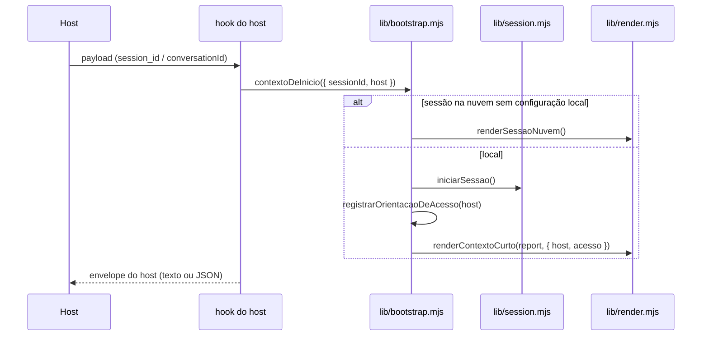

# Bootstrap da sessão

Todo host chama a mesma função, `contextoDeInicio()` em `plugins/connect/lib/bootstrap.mjs`.
O hook de cada host só lê o payload e embrulha a saída no formato dele.

## O que entra no contexto

Em ordem de prioridade, dentro do teto de ~9.000 caracteres:

1. **Bloco acionável:** governança da matriz, pedido de acesso às pastas, 1º uso (matriz não
   configurada) e perfil do operador não provisionado.
2. **Sessão iniciada:** workspace da sessão, operador, atalhos montados.
3. **Regras duras** (as 5, de `lib/regras.mjs`).
4. **Camada 1:** ponteiro para a carta de navegação, não a carta inteira.
5. Avisos e a **camada 0** do operador.

## O que muda por host

Só os blocos declarados em `BLOCOS_POR_HOST` (`tests/architecture/paridade.mjs`):

| Bloco | Cowork | Outros hosts |
|---|---|---|
| Acesso às pastas | inteiro em toda sessão | inteiro na 1ª sessão do host, depois lembrete ([conceito](../conceitos/acesso-no-ritmo-do-host.md)) |
| Governança da matriz | "procure o marcador CNCT-GOV no contexto" (vem pela pasta conectada) | "leia `{workspace}/matriz/CLAUDE.md`" |
| Camada 1 | carta na pasta conectada | caminho completo no workspace da sessão |
| Diretório de trabalho | — | aviso de que os atalhos ficam no workspace da sessão |

O resto tem de sair idêntico nos quatro hosts; o teste "mesmo contexto" compara.

## Sessão na nuvem

Com `CLAUDE_CODE_REMOTE=true` (ou `CONNECT_EXECUCAO=nuvem`) e sem configuração local, o hook
**orienta** em vez de diagnosticar 1º uso: o estado do operador está na máquina dele. Ver
`lib/ambiente.mjs`.
