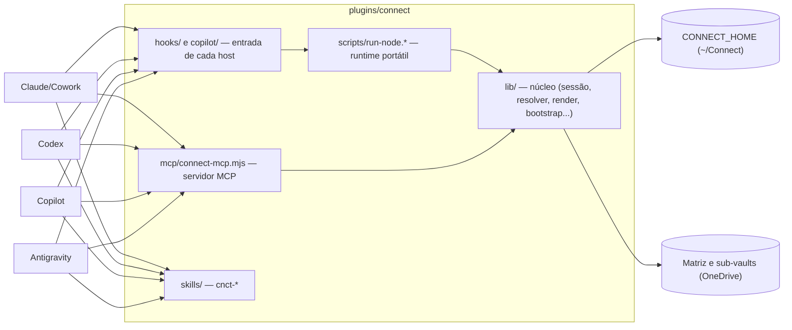

# Visão geral

O Connect é **um mecanismo** entregue a vários hosts de agente. O que muda de um host para
outro é só a superfície que ele lê (manifesto, config de MCP, hooks). O resto é o mesmo
código, nos mesmos arquivos.

## As peças

| Peça | Onde | Papel |
|---|---|---|
| Núcleo | `plugins/connect/lib/` | Toda a lógica: iniciar sessão, montar atalhos, resolver conceito, sincronizar OneDrive, renderizar contexto. Zero dependência externa. |
| Servidor MCP | `plugins/connect/mcp/connect-mcp.mjs` | Expõe o núcleo como tools. stdio por padrão; HTTP local opcional. |
| Bootstrap | `plugins/connect/lib/bootstrap.mjs` | Decide o texto que todo hook injeta no início da sessão. |
| Hooks | `hooks/*.mjs`, `copilot/*.mjs` | Envelope por host em volta do mesmo bootstrap; guarda de varredura. |
| Skills | `plugins/connect/skills/` | Instruções para o agente (onboarding, escrita, encerramento, fábricas). |
| Runtime | `plugins/connect/scripts/` | Garante o Node portátil para hooks e MCP em qualquer host. |

## Princípios

1. **Um código, vários envelopes.** Nada de lógica duplicada por host: o host muda o formato da
   entrada e da saída, nunca a decisão. Ver [bootstrap](bootstrap.md).
2. **Hosts são pares.** O Cowork é a referência da migração, não uma dependência. Ver
   [paridade e limiar](../conceitos/paridade-e-limiar.md).
3. **Estado é da máquina, não do host.** Todos usam o mesmo `CONNECT_HOME` (padrão `~/Connect`).
4. **Agnóstico de cliente.** Nada de cliente no plugin; conhecimento de cliente mora no vault.
5. **Sem controle genérico da máquina.** O MCP só tem operações nomeadas. Ver
   [fronteira de controle](../host-control-boundary.md).
6. **O build prova.** Toda regra acima tem teste. Ver [testes](testes.md).
